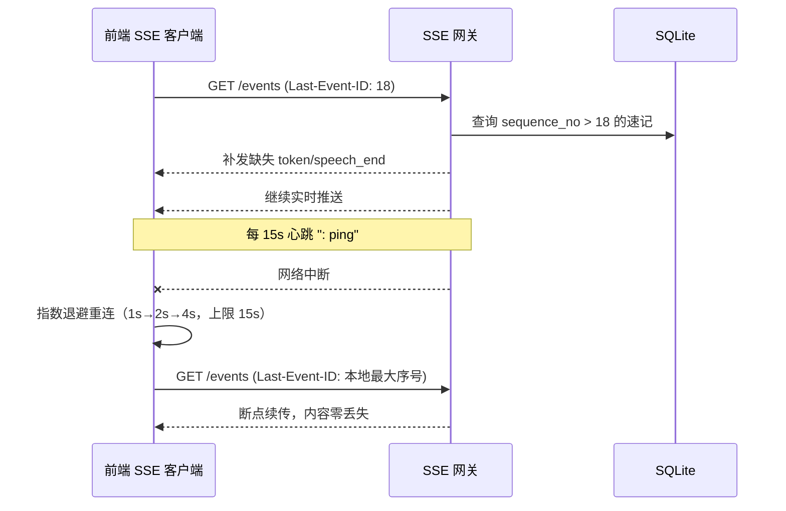

# AI Panel Studio 接口契约（REST + SSE）

| 项目 | 内容 |
| --- | --- |
| 文档版本 | v1.0 |
| Base URL | `http://localhost:8000/api` |
| 内容类型 | 请求/响应 `application/json; charset=utf-8`；事件流 `text/event-stream` |
| 时间格式 | ISO 8601 UTC，例：`2026-11-17T08:30:00.123Z` |
| 关联文档 | [PRD.md](./PRD.md) · [ARCHITECTURE.md](./ARCHITECTURE.md) |

---

## 0. 通用约定

### 0.1 统一响应信封

**单资源成功（2xx）**

```json
{
  "data": { },
  "meta": { "request_id": "req_7f3a91" }
}
```

**列表成功（2xx）**

```json
{
  "data": [ ],
  "meta": { "request_id": "req_7f3a91", "total": 12, "has_more": false }
}
```

**错误（4xx / 5xx）**

```json
{
  "error": {
    "code": "ROOM_NOT_ACTIVE",
    "message": "房间当前状态为 draft，无法建立事件通道",
    "details": { "room_id": 12, "status": "draft" }
  },
  "meta": { "request_id": "req_7f3a91" }
}
```

### 0.2 错误码表

| HTTP | code | 语义 |
| --- | --- | --- |
| 400 | `INVALID_PARAMETER` | 参数格式错误 |
| 404 | `ROOM_NOT_FOUND` | 房间不存在 |
| 409 | `INVALID_STATE_TRANSITION` | 非法状态流转（如 finished 再激活） |
| 409 | `ROOM_NOT_ACTIVE` | 房间非 active，不可订阅事件流 |
| 422 | `TOPIC_TOO_SHORT` / `TOPIC_TOO_LONG` | 议题长度越界 |
| 429 | `ROOM_CONCURRENCY_LIMIT` | 并发房间数达上限 |
| 502 | `LLM_UPSTREAM_ERROR` | 模型服务异常（不含原始报文） |
| 504 | `LLM_TIMEOUT` | 模型调用超时 |
| 500 | `INTERNAL_ERROR` | 未预期异常 |

### 0.3 契约红线

1. 响应体中**绝不出现**大模型原始 JSON、提示词、CoT、内部打分或调度日志。
2. 所有字段必须是本文件已声明的领域字段，新增字段需同步更新本文档。
3. 时间统一 UTC，前端负责本地化展示。

### 0.4 领域枚举

| 枚举 | 取值 |
| --- | --- |
| `room.status` | `draft` · `active` · `finished` |
| `persona.current_status` | `idle` · `thinking` · `speaking` |
| `speech_type` | `intro` · `speech` · `counter` · `summary` |
| `insight.type` | `consensus` · `divergence` |

---

## 1. REST 接口

### 1.1 创建房间（含阵容生成）

```
POST /api/rooms
```

**请求体**

| 字段 | 类型 | 必填 | 约束 | 说明 |
| --- | --- | --- | --- | --- |
| topic | string | 是 | 1–200 字，服务端 trim | 讨论议题 |
| expert_count | integer | 否 | 1–8，默认 4 | 专家数量（MVP 固定 4） |
| style | string | 否 | `balanced` / `debate` / `exploratory`，默认 `balanced` | 讨论风格，影响阵容生成倾向 |

```json
{
  "topic": "我们该不该把单体服务拆成微服务？",
  "expert_count": 4,
  "style": "debate"
}
```

**响应 201**

```json
{
  "data": {
    "room": {
      "id": 12,
      "topic": "我们该不该把单体服务拆成微服务？",
      "status": "draft",
      "expert_count": 4,
      "summary": null,
      "created_at": "2026-11-17T08:30:00.123Z",
      "finished_at": null
    },
    "personas": [
      {
        "id": 101,
        "name": "沈知远",
        "title": "圆桌主持人 · 科技观察者",
        "stance": "中立引导，负责串联观点与收束结论",
        "color_theme": "#6C7A89",
        "is_host": true,
        "current_status": "idle",
        "current_focus": "介绍议题与在场专家"
      },
      {
        "id": 102,
        "name": "林岸",
        "title": "平台架构师",
        "stance": "强烈支持拆分，认为组织规模决定架构形态",
        "color_theme": "#E4572E",
        "is_host": false,
        "current_status": "idle",
        "current_focus": null
      },
      {
        "id": 103,
        "name": "周砚",
        "title": "单体系统维护者",
        "stance": "反对过早拆分，强调分布式复杂度成本",
        "color_theme": "#2E86AB",
        "is_host": false,
        "current_status": "idle",
        "current_focus": null
      },
      {
        "id": 104,
        "name": "许听",
        "title": "组织效能顾问",
        "stance": "条件性支持，主张先改组织再谈架构",
        "color_theme": "#7A9E3F",
        "is_host": false,
        "current_status": "idle",
        "current_focus": null
      },
      {
        "id": 105,
        "name": "顾临",
        "title": "成本与稳定性工程师",
        "stance": "审慎怀疑，关注运维负担与故障面扩大",
        "color_theme": "#B565A7",
        "is_host": false,
        "current_status": "idle",
        "current_focus": null
      }
    ]
  },
  "meta": { "request_id": "req_7f3a91" }
}
```

**业务约束**

- 返回 1 位 `is_host = true` 与 `expert_count` 位专家。
- 同一房间内 `color_theme` 互不相同。
- 生成失败时降级为模板化阵容，**仍返回 201**，并在 `meta.degraded = true` 标注。

---

### 1.2 获取历史房间列表

```
GET /api/rooms?status={status}&page={page}&page_size={page_size}
```

| 参数 | 类型 | 必填 | 默认 | 说明 |
| --- | --- | --- | --- | --- |
| status | string | 否 | — | 按状态过滤 |
| page | integer | 否 | 1 | 页码，≥ 1 |
| page_size | integer | 否 | 20 | 每页条数，1–50 |

**响应 200**

```json
{
  "data": [
    {
      "id": 12,
      "topic": "我们该不该把单体服务拆成微服务？",
      "status": "finished",
      "expert_count": 4,
      "summary_excerpt": "共识：拆分应以组织边界为前提……",
      "created_at": "2026-11-17T08:30:00.123Z",
      "finished_at": "2026-11-17T08:42:11.004Z"
    }
  ],
  "meta": { "request_id": "req_7f3a91", "total": 1, "has_more": false }
}
```

---

### 1.3 获取房间详情

```
GET /api/rooms/{id}
```

**响应 200**：结构同 1.1 的 `data`，另附运行态聚合字段：

```json
{
  "data": {
    "room": { "id": 12, "status": "active", "summary": null },
    "personas": [ ],
    "progress": {
      "transcript_count": 18,
      "last_sequence_no": 18,
      "insight_version": 6
    }
  },
  "meta": { "request_id": "req_7f3a91" }
}
```

---

### 1.4 重新生成阵容（换一批）

```
POST /api/rooms/{id}/personas/regenerate
```

- 仅允许 `status = draft`，否则返回 409 `INVALID_STATE_TRANSITION`。
- 覆盖旧阵容（旧 personas 级联删除其速记），重置 `progress`。

**响应 200**：同 1.1 的 `data`。

---

### 1.5 确认进入演播厅

```
POST /api/rooms/{id}/activate
```

**请求体**：无（`{}` 可选）。

**响应 200**

```json
{
  "data": {
    "id": 12,
    "status": "active",
    "activated_at": "2026-11-17T08:31:02.551Z",
    "events_url": "/api/rooms/12/events"
  },
  "meta": { "request_id": "req_7f3a91" }
}
```

**业务约束**

- 状态机仅允许 `draft → active`；重复激活返回 200 幂等结果。
- `activate` 成功后后端登记讨论任务，等待首个 SSE 连接触发启动。

---

### 1.6 拉取速记（历史 / 断线补拉）

```
GET /api/rooms/{id}/transcripts?after_sequence_no={n}&limit={limit}
```

| 参数 | 类型 | 必填 | 默认 | 说明 |
| --- | --- | --- | --- | --- |
| after_sequence_no | integer | 否 | 0 | 仅返回序号大于该值的速记 |
| limit | integer | 否 | 200 | 1–500 |

**响应 200**

```json
{
  "data": [
    {
      "id": 501,
      "persona_id": 102,
      "persona_name": "林岸",
      "sequence_no": 7,
      "content": "拆分的真正门槛不是技术，而是团队边界是否清晰。",
      "speech_type": "speech",
      "created_at": "2026-11-17T08:33:10.002Z"
    }
  ],
  "meta": {
    "request_id": "req_7f3a91",
    "last_sequence_no": 7,
    "has_more": false
  }
}
```

---

### 1.7 获取共识与分歧看板

```
GET /api/rooms/{id}/insights?version={version}
```

- 省略 `version` 返回当前最新看板；指定则返回该历史快照。

**响应 200**

```json
{
  "data": {
    "version": 6,
    "updated_at": "2026-11-17T08:40:12.880Z",
    "items": [
      { "id": 31, "type": "consensus", "content": "拆分需以清晰的团队边界为前提" },
      { "id": 32, "type": "divergence", "content": "拆分时机：现在动手还是等规模达标" }
    ]
  },
  "meta": { "request_id": "req_7f3a91" }
}
```

---

### 1.8 接口总览

| 方法 | 路径 | 用途 | 成功码 |
| --- | --- | --- | --- |
| POST | `/api/rooms` | 创建房间并生成阵容 | 201 |
| GET | `/api/rooms` | 历史房间列表 | 200 |
| GET | `/api/rooms/{id}` | 房间详情 | 200 |
| POST | `/api/rooms/{id}/personas/regenerate` | 换一批阵容 | 200 |
| POST | `/api/rooms/{id}/activate` | 确认进入演播厅 | 200 |
| GET | `/api/rooms/{id}/transcripts` | 拉取速记 | 200 |
| GET | `/api/rooms/{id}/insights` | 获取看板 | 200 |
| GET | `/api/rooms/{id}/events` | SSE 事件通道 | 200 |

---

## 2. SSE 事件通道

### 2.1 连接

```
GET /api/rooms/{id}/events
Accept: text/event-stream
Last-Event-ID: 18        # 可选，断线续传
```

**前置条件**：`rooms.status = active`，否则返回 409 `ROOM_NOT_ACTIVE`（HTTP 层直接返回 JSON 错误，不建立流）。

**响应头**

```
Content-Type: text/event-stream; charset=utf-8
Cache-Control: no-cache, no-transform
Connection: keep-alive
X-Accel-Buffering: no
```

### 2.2 事件帧格式

每个事件严格遵循 SSE 规范，`id` 为该事件对应的速记序号（无速记时沿用上一条），`event` 为事件名，`data` 为**单行压缩 JSON**：

```
id: 7
event: token
data: {"room_id":12,"persona_id":102,"sequence_no":7,"speech_type":"speech","delta":"拆","token_index":0}

```

- `data` 内不得包含换行；如内容含换行，必须转义为 `\n`。
- 未识别的事件名，客户端必须忽略且不影响后续处理。
- 服务端每 15s 发送心跳注释：`: ping`。

### 2.3 事件总览

| 事件 | 触发时机 | 频率 | 客户端处理 |
| --- | --- | --- | --- |
| `token` | 发言逐字生成时 | 高（20–80ms/次） | 追加到当前气泡，驱动打字机 |
| `status_change` | 专家状态切换 | 中 | 更新对应小窗呼吸灯与关注点 |
| `insight_update` | 看板版本刷新 | 低 | 整体替换看板条目 |
| `speech_end` | 单次发言结束并落库 | 每发言 1 次 | 定稿气泡、清空缓冲、递增序号 |
| `summary` | 主持人总结完成、房间结束 | 每房间 1 次 | 展示总结卡片并关闭连接 |

---

### 2.4 `event: token` —— 发言打字机单字流

**载荷**

| 字段 | 类型 | 必填 | 说明 |
| --- | --- | --- | --- |
| room_id | integer | 是 | 房间 ID |
| persona_id | integer | 是 | 发言人 ID |
| sequence_no | integer | 是 | 本条发言的全局序号 |
| speech_type | string | 是 | `intro` / `speech` / `counter` / `summary` |
| delta | string | 是 | 本次增量文本（通常 1–3 个字符） |
| token_index | integer | 是 | 本条发言内的 token 序号，从 0 递增 |

```
id: 7
event: token
data: {"room_id":12,"persona_id":102,"sequence_no":7,"speech_type":"speech","delta":"拆","token_index":0}
```

**客户端契约**

- 按 `sequence_no` 归并；同一 `sequence_no` 的 `delta` 依 `token_index` 顺序追加。
- 收到 `token` 时若该专家状态非 `speaking`，客户端可本地纠正为 `speaking`，但以 `status_change` 为准。

---

### 2.5 `event: status_change` —— 专家呼吸灯状态切换

**载荷**

| 字段 | 类型 | 必填 | 说明 |
| --- | --- | --- | --- |
| room_id | integer | 是 | 房间 ID |
| persona_id | integer | 是 | 专家 ID |
| status | string | 是 | `idle` / `thinking` / `speaking` |
| current_focus | string \| null | 否 | 可公开的当前关注点，≤ 120 字 |
| changed_at | string | 是 | 状态切换时间 |

```
id: 7
event: status_change
data: {"room_id":12,"persona_id":102,"status":"thinking","current_focus":"评估团队边界与拆分的先后顺序","changed_at":"2026-11-17T08:33:07.410Z"}
```

**客户端契约**

- 仅更新目标小窗，不改动其他专家状态。
- `current_focus` 是可公开信息，**不含任何内部推理过程**。

---

### 2.6 `event: insight_update` —— 共识分歧动态刷新

**载荷**

| 字段 | 类型 | 必填 | 说明 |
| --- | --- | --- | --- |
| room_id | integer | 是 | 房间 ID |
| version | integer | 是 | 房间级看板版本，单调递增 |
| items | array | 是 | 该版本完整条目快照 |
| items[].id | integer | 是 | 条目 ID |
| items[].type | string | 是 | `consensus` / `divergence` |
| items[].content | string | 是 | 条目内容，≤ 300 字 |
| updated_at | string | 是 | 快照生成时间 |

```
id: 8
event: insight_update
data: {"room_id":12,"version":3,"items":[{"id":21,"type":"consensus","content":"拆分需以清晰的团队边界为前提"},{"id":22,"type":"divergence","content":"拆分时机：现在动手还是等规模达标"}],"updated_at":"2026-11-17T08:35:20.114Z"}
```

**客户端契约**

- 全量替换语义：`items` 即当前版本完整看板，不做增量合并。
- 若收到的 `version` 小于本地版本，直接丢弃（乱序保护）。

---

### 2.7 `event: speech_end` —— 单次发言结束

**载荷**

| 字段 | 类型 | 必填 | 说明 |
| --- | --- | --- | --- |
| room_id | integer | 是 | 房间 ID |
| transcript_id | integer | 是 | 落库后的速记 ID |
| persona_id | integer | 是 | 发言人 ID |
| sequence_no | integer | 是 | 本条发言序号 |
| speech_type | string | 是 | 发言类型 |
| content | string | 是 | **校验后的完整正文**（已满足 1–2 句约束） |
| sentence_count | integer | 是 | 句数 |
| char_count | integer | 是 | 字符数 |
| created_at | string | 是 | 入库时间 |

```
id: 7
event: speech_end
data: {"room_id":12,"transcript_id":501,"persona_id":102,"sequence_no":7,"speech_type":"speech","content":"拆分的真正门槛不是技术，而是团队边界是否清晰。","sentence_count":1,"char_count":24,"created_at":"2026-11-17T08:33:11.207Z"}
```

**客户端契约**

- 以 `content` 覆盖本地拼接结果，修正可能的丢 token。
- 收到后将该发言人状态视为回到 `idle`（若随后收到 `status_change` 则以其为准）。
- `speech_end` 是**终态锚点**，任何缺失的 `token` 都在此对齐。

---

### 2.8 `event: summary` —— 主持人终结发言

**载荷**

| 字段 | 类型 | 必填 | 说明 |
| --- | --- | --- | --- |
| room_id | integer | 是 | 房间 ID |
| persona_id | integer | 是 | 主持人 ID |
| transcript_id | integer | 是 | 总结速记 ID |
| summary | string | 是 | 总结全文（自然语言，≤ 600 字） |
| consensus | array\<string\> | 是 | 核心共识要点 |
| divergence | array\<string\> | 是 | 主要分歧要点 |
| suggestions | array\<string\> | 否 | 可执行建议 |
| finished_at | string | 是 | 房间结束时间 |

```
id: 24
event: summary
data: {"room_id":12,"persona_id":101,"transcript_id":518,"summary":"本场围绕拆分时机展开……","consensus":["拆分需以团队边界清晰为前提"],"divergence":["当前规模下是否应立即动手"],"suggestions":["先用绞杀者模式试点一条业务线"],"finished_at":"2026-11-17T08:42:11.004Z"}
```

**客户端契约**

- 收到后展示总结卡片，并将房间状态置为 `finished`。
- 服务端在发送后关闭流；客户端应主动 `close()` 且**不再重连**。

---

### 2.9 连接生命周期与重连



| 场景 | 客户端行为 | 服务端行为 |
| --- | --- | --- |
| 正常断线 | 指数退避重连，携带 `Last-Event-ID` | 按序号补发 |
| 房间已 finished | 不重连，改为调用 1.6 / 1.7 拉取终态 | 返回 409 `ROOM_NOT_ACTIVE` |
| 事件流被代理缓冲 | 无需处理 | `X-Accel-Buffering: no` + 心跳 |
| 事件积压 | 无需处理 | 有界队列，丢弃旧 token 后由 `speech_end` 对齐 |

---

## 3. 前后端字段对照（防止模型结构泄漏）

| 领域字段 | 来源 | 是否允许出现在出站载荷 |
| --- | --- | --- |
| `content` / `delta` | 模型文本（已校验） | 允许 |
| `speech_type` | 编排器决策 | 允许 |
| `current_focus` | 编排器提炼的可公开摘要 | 允许 |
| 模型原始 JSON 字符串 | LLM 响应 | **禁止** |
| CoT / 内部提示词 | LLM 推理 | **禁止** |
| 调度器打分 / 候选排序 | 调度器 | **禁止** |

---

## 4. 契约变更流程

1. 任何字段增删改，先更新本文件并标注版本。
2. 后端同步更新 Pydantic 模型与 OpenAPI 输出。
3. 前端同步更新类型定义（`frontend/src/types`）。
4. 破坏性变更需在 `docs/` 下补充变更记录，并在 PR 中说明迁移方式。
