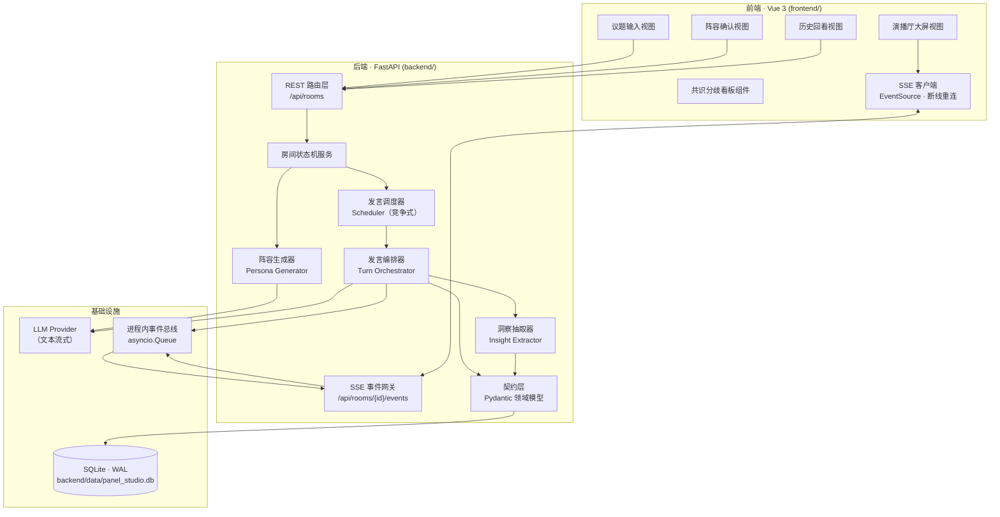
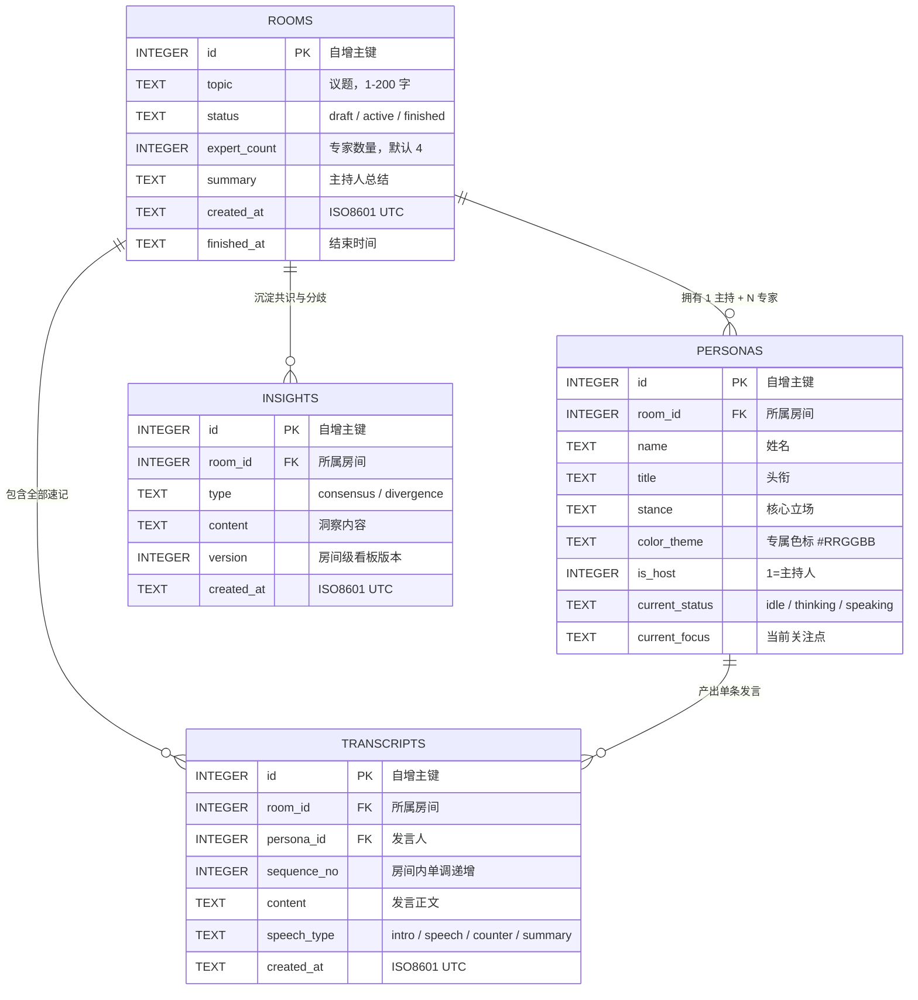
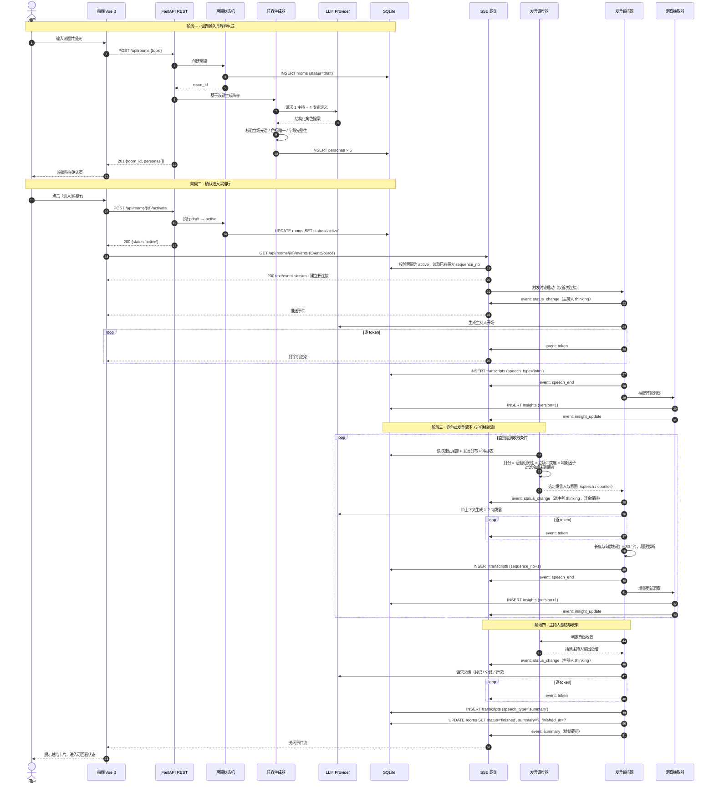

# AI Panel Studio 架构设计文档

| 项目 | 内容 |
| --- | --- |
| 文档版本 | v1.0 |
| 适用范围 | MVP 一期（单机房单体部署） |
| 技术栈 | Python 3.11 + FastAPI · SQLite（WAL）· Vue 3 + Vite · SSE |
| 关联文档 | [PRD.md](./PRD.md) · [API.md](./API.md) · [schema.sql](../backend/schema.sql) |

---

## 1. 架构目标与设计原则

| 目标 | 说明 |
| --- | --- |
| 职责单一 | 生成、调度、渲染、持久化四类关注点物理分离，互不越界 |
| 契约先行 | 前后端仅通过 [API.md](./API.md) 定义的领域契约通信，禁止透传模型结构 |
| 单向数据流 | 后端是唯一事实源，前端只做投影与渲染 |
| 可观测 | 房间、状态、发言、洞察全部落库，任意时刻可重放 |
| 渐进演进 | 一期单进程即可运行，后续可将调度器与 LLM 调用拆为独立 Worker |

**架构红线（对应 PRD 硬规则）**

1. 任何 LLM 原始输出在进入 SSE 通道前必须完成解析、校验、领域映射（HR-4）。
2. 调度器日志、思维链、内部打分只写本地日志，永不进入出站载荷（HR-3）。
3. 发言长度在「入库前」校验与截断，而非在渲染时（HR-1）。

---

## 2. 系统分层



**分层说明**

| 层 | 组成 | 职责 | 禁止事项 |
| --- | --- | --- | --- |
| 表现层 | Vue 3 视图与组件 | 渲染、交互、SSE 消费 | 不得解析模型 JSON、不得持有 CoT |
| 接入层 | FastAPI 路由 / SSE 网关 | 鉴权占位、参数校验、协议转换 | 不得包含业务规则 |
| 领域层 | 状态机 / 调度器 / 编排器 / 抽取器 | 硬规则执行、发言决策、洞察归并 | 不得直接操作 HTTP 上下文 |
| 适配层 | LLM Provider / 仓储 Repository | 外部依赖隔离、SQL 封装 | 不得向上抛出原始响应 |
| 存储层 | SQLite（WAL 模式） | 单一事实源 | 不得绕过仓储层写入 |

---

## 3. 核心模块职责

| 模块 | 输入 | 输出 | 关键约束 |
| --- | --- | --- | --- |
| 房间状态机服务 | 创建 / 确认 / 结束指令 | 状态迁移结果 | 仅允许 draft→active→finished |
| 阵容生成器 | 议题 + 风格 | 1 主持 + 4 专家 | 立场需构成光谱；色标房间内唯一 |
| 发言调度器 | 速记尾部 + 各专家状态 | 下一位发言人及意图 | 非机械轮流：冷却 + 冲突度择优 + 均衡 |
| 发言编排器 | 发言人 + 意图 + 上下文 | token 流 → 完整发言 | 1–2 句、≤ 80 字；超限截断 |
| 洞察抽取器 | 最近 N 轮速记 | 共识/分歧条目 + 新版本 | 版本号房间内单调递增 |
| SSE 事件网关 | 进程内事件总线 | 标准 5 类事件 | 心跳保活、Last-Event-ID 续传 |

---

## 4. 数据实体关系（ER 图）



**关系说明**

| 关系 | 基数 | 约束 |
| --- | --- | --- |
| rooms → personas | 1 : N（N = expert_count + 1） | 级联删除；每房间仅 1 位 is_host=1 |
| rooms → transcripts | 1 : N | 级联删除；(room_id, sequence_no) 唯一 |
| rooms → insights | 1 : N | 级联删除；version 房间内递增 |
| personas → transcripts | 1 : N | 级联删除；发言必须归属本房间角色 |

> 数据完整性由数据库约束（CHECK / UNIQUE / FOREIGN KEY）兜底，应用层做语义校验，形成双重防护。

---

## 5. 系统交互时序（发起议题 → 总结收束）



---

## 6. 关键机制设计

### 6.1 竞争式发言调度（对应 HR-2）

每次派发前计算候选分数，取 Top-1：

```
score(p) = w1 · relevance(p, recent_context)
         + w2 · conflict(p.stance, last_speaker.stance)
         + w3 · balance(1 - p.speak_count / total_speaks)
         - w4 · cooldown_penalty(p)
```

| 约束 | 实现方式 | 否决条件 |
| --- | --- | --- |
| 冷却 | 记录每位专家上次发言的 sequence_no | 间隔 < 1 次他人发言则剔除 |
| 冲突度 | 立场向量/标签化对立关系 | 连续两次同立场者不成对出现 |
| 均衡 | 实时统计发言占比 | 某人占比 > 40% 时大幅降权 |
| 防死循环 | 单场上限（≤ 20 轮） | 达上限强制进入总结 |

### 6.2 流式发言与长度硬约束（对应 HR-1 / HR-4）

1. LLM 以流式返回**纯文本片段**，经编排器聚合缓冲区。
2. 缓冲区按句末标点切分句数；超过 2 句或 80 字时立即截断并终止后续生成。
3. 仅将校验后的 `content` 落库，再向 SSE 推送 `speech_end`。
4. 任何模型原始 JSON 在解析后即丢弃，仅保留领域字段。

### 6.3 SSE 通道设计（对应 HR-3）

- 单房间单通道，事件类型固定 5 种（见 [API.md](./API.md)）。
- 心跳：每 15s 发送注释行 `: ping`，防止代理层超时断链。
- 续传：客户端携带 `Last-Event-ID`，服务端从该 `sequence_no` 之后补发。
- 背压：进程内 `asyncio.Queue` 有界（如 256），溢出时丢弃最旧的 token 事件并补发 `speech_end`，保证终态一致。

### 6.4 洞察版本管理

- `version` 为房间级看板版本，每次刷新 +1，同批写入的多条条目共享该版本。
- 前端按最大 version 渲染当前看板，历史版本可用于「观点演化」回放。

---

## 7. 目录与部署形态

```
D:\ai-panel-studio\
├── docs/
│   ├── PRD.md              # 产品需求
│   ├── ARCHITECTURE.md     # 架构设计（本文）
│   └── API.md              # REST + SSE 契约
├── backend/
│   ├── data/               # SQLite 数据文件目录
│   │   └── panel_studio.db # 运行时生成
│   └── schema.sql          # 数据库基线脚本
└── frontend/               # Vue 3 应用
```

**一期部署**：单机单进程，FastAPI 同时承载 REST 与 SSE；SQLite 开启 WAL 以支持「写发言 + 读回放」并发。

**演进路径**

| 阶段 | 变化点 |
| --- | --- |
| 二期 | 调度器与 LLM 调用拆为独立 Worker，事件总线换 Redis Pub/Sub |
| 三期 | SQLite → PostgreSQL；新增用户体系与房间权限 |
| 四期 | 引入向量检索做立场相关性打分；支持语音与数字人渲染 |

---

## 8. 非功能设计对照

| 需求（PRD §5） | 架构手段 |
| --- | --- |
| TTFT ≤ 3s | 开场发言与连接建立并行触发；LLM 流式直出 |
| 断线零丢失 | `Last-Event-ID` + 速记全量落库 |
| 状态一致 | 数据库约束 + 状态机服务单点收口 |
| 敏感信息不泄漏 | 出站 DTO 白名单构造，禁止模型对象直传 |
| 单场 ≤ 20 轮 | 调度器轮次预算与收敛判定 |

---

## 9. 架构决策记录（ADR 摘要）

| 编号 | 决策 | 备选方案 | 结论与理由 |
| --- | --- | --- | --- |
| ADR-001 | SSE 而非 WebSocket | WebSocket | 讨论为服务端单向推送，SSE 更简单、天然支持断点续传与 HTTP 生态 |
| ADR-002 | SQLite + WAL | PostgreSQL | MVP 单机、零运维；WAL 满足读写并发；后续平滑迁移 |
| ADR-003 | 进程内事件总线 | 消息队列 | 一期单进程，避免过度设计；接口抽象保留替换空间 |
| ADR-004 | 后端硬截断发言 | 前端截断 | 事实源必须是干净的，避免脏数据入库与回放不一致 |
| ADR-005 | 版本化洞察快照 | 原地更新 | 保留演化过程，支撑「观点如何形成」的可解释性 |
