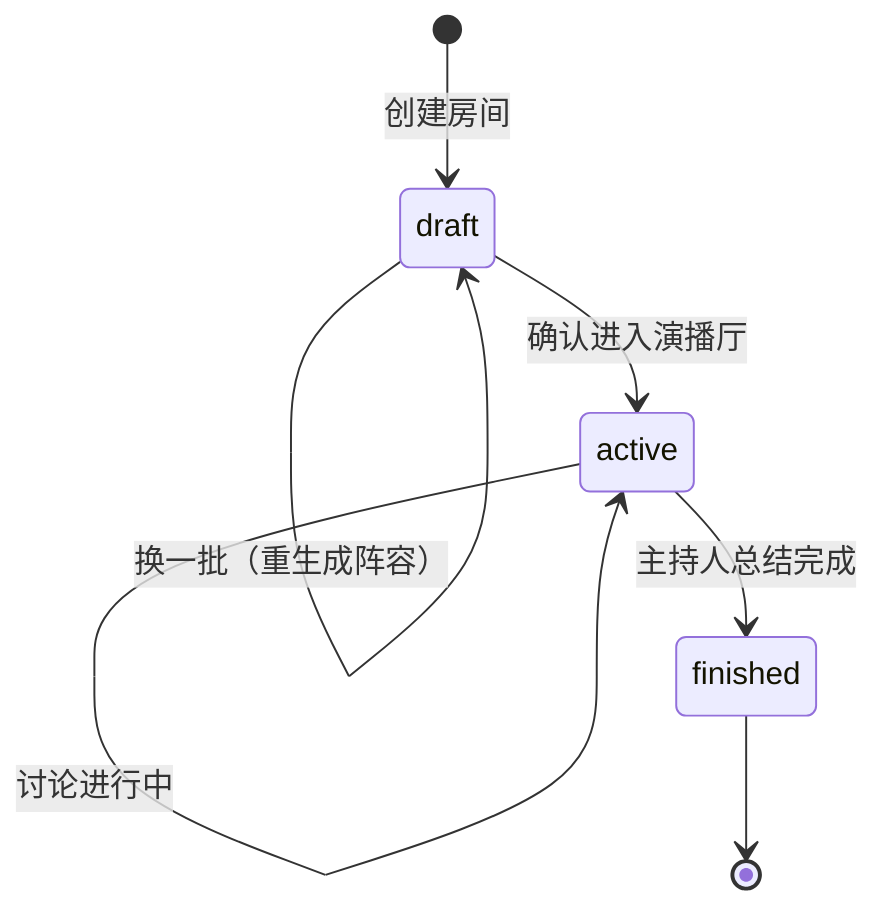
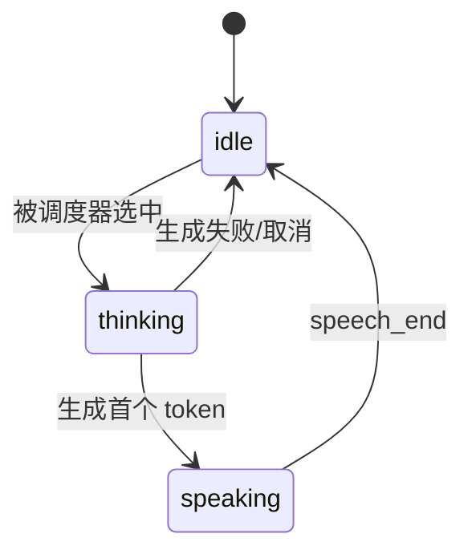

# AI Panel Studio 产品需求文档（PRD）

| 项目 | 内容 |
| --- | --- |
| 产品名称 | AI Panel Studio（AI 圆桌讨论演播厅） |
| 文档版本 | v1.0 |
| 文档状态 | 一期基线（MVP）· 已评审待冻结 |
| 撰写角色 | 产品负责人 / 架构师 |
| 更新时间 | 2026-11-17 |
| 关联文档 | [ARCHITECTURE.md](./ARCHITECTURE.md) · [API.md](./API.md) · [schema.sql](../backend/schema.sql) |

---

## 1. 产品概述

### 1.1 一句话定义

用户抛出一个议题，AI 现场组建一场「1 位主持人 + 4 位专家」的圆桌讨论，在演播厅大屏上以短促、真实、有交锋感的方式实时辩论，并持续沉淀出共识与分歧，最终由主持人自然语言收束。

### 1.2 核心价值主张

| 价值维度 | 现状痛点 | 本产品提供的解法 |
| --- | --- | --- |
| 信息增量 | 单一对话模型给出「四平八稳」的综合答案，缺乏对立视角 | 多角色独立立场建模，观点天然冲突，用户在交锋中看见盲区 |
| 认知效率 | 长文阅读成本高，用户难以快速抓重点 | 单次发言硬约束 1–2 句，信息密度极高，可跟读 |
| 结论可信 | 结论是「一次性生成」的，中间推理不可见、不可追问 | 共识/分歧以看板形式随讨论演化，过程可观测、可复盘 |
| 沉浸体验 | 聊天框形态平淡，缺乏「现场感」 | 演播厅大屏 + 专家独立状态小窗 + 呼吸灯，营造临场感 |
| 可复用资产 | 讨论内容散落，难以二次利用 | 房间、速记、共识全部落库，支持历史回看与总结导出 |

**价值主张总结（Elevator Pitch）**

> 不是「问 AI 一个答案」，而是「看一场关于你议题的高质量圆桌」。

### 1.3 目标用户与场景

| 用户画像 | 典型诉求 | 典型议题示例 |
| --- | --- | --- |
| 产品/战略从业者 | 需要多视角压测一个决策 | 「明年的核心增长点应该押注海外还是下沉市场？」 |
| 技术决策者 | 需要技术选型的正反方论证 | 「我们该不该把单体服务拆成微服务？」 |
| 内容创作者 | 需要可复用的观点素材 | 「远程办公真的提升生产力吗？」 |
| 泛学习者 | 需要低成本理解复杂议题 | 「AI 会消灭程序员吗？」 |

### 1.4 本期范围（MVP In-Scope）

- 议题输入与房间创建
- 动态生成 1 主持人 + 4 专家阵容（含立场与专属色标）
- 阵容确认页
- 演播厅大屏实时讨论（SSE 流式渲染）
- 实时共识与分歧看板
- 主持人自然语言总结
- 历史房间回看

### 1.5 本期不做（Out-of-Scope）

- 用户账号体系与权限（房间通过不可猜测 ID 访问）
- 多轮追问与用户插话
- 语音合成 / 数字人渲染
- 付费与用量计费
- 专家阵容的人工自定义编辑（一期仅支持「换一批」重生成）

---

## 2. 核心用户旅程

整体链路：

```
议题输入 → 动态生成阵容(1 主持 + 4 专家) → 阵容确认 → 演播厅大屏交锋
        → 实时共识/分歧沉淀 → 主持人总结 → 历史回看
```

### 2.1 旅程分阶段定义

| 阶段 | 用户动作 | 系统行为 | 用户情绪目标 | 完成判定 |
| --- | --- | --- | --- | --- |
| ① 议题输入 | 输入议题文本（≤ 200 字），可选选择讨论风格 | 校验议题、创建 `rooms` 记录（status=draft） | 期待、低门槛 | 房间创建成功并返回 room_id |
| ② 阵容生成 | 无需操作，等待 ≤ 8s | 依据议题生成 1 主持人 + 4 专家，写入 `personas`，分配立场、专属色标 | 惊喜、信任 | 5 个 persona 落库且均含 stance 与 color_theme |
| ③ 阵容确认 | 浏览阵容，点击「进入演播厅」或「换一批」 | 「换一批」重生成阵容；「进入演播厅」将房间置为 active | 掌控感 | rooms.status 由 draft → active |
| ④ 演播厅交锋 | 观看大屏，专家状态小窗实时呼吸灯变化 | 建立 SSE 长连接，调度器竞争式派发发言，逐字下发 token | 沉浸、紧张感 | 首条 intro 发言在 3s 内开始流式输出 |
| ⑤ 共识分歧 | 观看右侧看板自动刷新 | 每轮发言后抽取/更新 insights，版本号递增 | 清晰、有收获 | insights 至少产生 2 条且持续更新 |
| ⑥ 主持人总结 | 观看总结收束 | 主持人输出 summary，写入 rooms.summary，房间置 finished | 圆满、可带走结论 | status=finished 且 summary 非空 |
| ⑦ 历史回看 | 在历史列表点击房间 | 只读回放速记与共识看板 | 可复用 | 历史房间可完整读取速记与 insights |

### 2.2 关键旅程细节约束

**阶段 ② 阵容生成**
- 固定为 1 位主持人 + 4 位专家，`expert_count = 4`。
- 4 位专家立场必须构成「可辩论光谱」：至少包含 1 个支持倾向、1 个反对倾向、其余可为中立/条件性立场，避免同质化。
- 每位专家必须有独立 `color_theme`（十六进制），前端用于发言气泡、状态小窗、看板标记。
- 生成失败时降级为「模板化阵容」，不得阻塞进入演播厅。

**阶段 ④ 演播厅交锋**
- 首条发言固定为 `speech_type = intro`（主持人开场，介绍议题与在场专家）。
- 后续发言为 `speech`（陈述观点）与 `counter`（针对他人观点的反驳/补强）。
- 发言顺序**不得机械轮流**，由调度器按「话题相关性 + 立场冲突度 + 冷却时间」竞争产生。
- 每位专家的当前关注点 `current_focus` 随发言动态更新，并在状态小窗展示。

**阶段 ⑤ 共识分歧**
- 看板条目分为 `consensus`（共识）与 `divergence`（分歧）两类。
- 每次更新产生新版本（`version` 自增），保留历史版本以支撑「演化过程」展示。

**阶段 ⑥ 总结**
- 总结必须由主持人（`is_host = 1`）产出，`speech_type = summary`。
- 总结须覆盖：核心共识、主要分歧、可执行建议三要素。

---

## 3. 核心业务硬规则（Hard Rules）

> 以下规则为不可协商的系统级约束，任何实现不得绕过。

### HR-1 单次发言 1–2 句，杜绝长篇大论

- 每位专家单次发言（`speech` / `counter`）**只允许 1–2 个句子**。
- 硬性字数上限：**≤ 80 个汉字**（英文按词计 ≤ 50 words）。
- 超限处理：后端在入库前进行截断或触发一次「压缩重述」，**绝不将超长文本写入 `transcripts`**。
- 设计意图：制造「短兵相接」的节奏感，保证大屏可跟读，避免退化为长文阅读。

| 发言类型 | 句数约束 | 字数上限 | 说明 |
| --- | --- | --- | --- |
| intro | 1–3 句 | ≤ 120 字 | 主持人开场，允许略长 |
| speech | 1–2 句 | ≤ 80 字 | 专家陈述观点 |
| counter | 1–2 句 | ≤ 80 字 | 专家反驳/补强 |
| summary | 不限句数 | ≤ 600 字 | 主持人终结总结，允许结构化 |

### HR-2 非机械轮流发言

- 禁止 `A → B → C → D → A → B …` 的固定轮转。
- 必须满足：
  1. 同一专家连续两次发言之间，**至少间隔 1 次其他专家的发言**（冷却约束）；
  2. 相邻两次发言的专家**立场冲突度**应高于随机水平（择优约束）；
  3. 每位专家在整场讨论中发言次数分布不出现「某位专家独占 > 40%」的失衡（均衡约束）。
- 调度决策过程属于内部逻辑，前端不感知，仅通过 `status_change` 与 `speech_end` 事件体现。

### HR-3 专家状态独立小窗，且不展示隐私 CoT 思维链

- 每位专家拥有独立状态小窗，展示：头像/色标、姓名、头衔、当前状态、当前关注点。
- 状态枚举固定为 `idle`（待机）、`thinking`（思考中）、`speaking`（发言中），通过呼吸灯动画区分。
- **严禁**向前端输出任何模型的 Chain-of-Thought、内部提示词、打分中间值、调度器决策日志。
- 前端小窗只允许展示「可对用户公开的当前关注点（`current_focus`）」这一层信息。

### HR-4 严禁前端直接暴露大模型原始 JSON

- 大模型返回的原始 JSON **不得**出现在任何 HTTP 响应体、SSE 事件载荷、前端 state 或 DOM 中。
- 所有模型输出必须经后端「解析 → 校验 → 领域对象映射」后再返回；解析失败时返回结构化错误码，原始文本仅落内部日志。
- 前端渲染只接受契约化的领域字段（见 [API.md](./API.md)）。

### HR-5 数据与状态一致性

- `rooms.status` 流转必须单向：`draft → active → finished`，不允许回退。
- 只有 `status = active` 的房间允许建立 SSE 事件通道；`finished` 房间仅提供只读回放接口。
- `transcripts.sequence_no` 在同一房间内严格单调递增且唯一，保证回放顺序确定性。

---

## 4. 功能需求

### FR-1 议题输入与房间创建

| 编号 | 需求 | 优先级 |
| --- | --- | --- |
| FR-1.1 | 支持输入议题，长度 1–200 字，前后空白需裁剪 | P0 |
| FR-1.2 | 提供 3–5 个示例议题，便于一键填充 | P1 |
| FR-1.3 | 创建成功后返回 `room_id`，进入阵容生成等待态 | P0 |
| FR-1.4 | 生成阶段提供明确的加载反馈（骨架屏 + 阶段文案） | P1 |

*验收标准*：输入合法议题，≤ 8s 内返回含 5 个角色的阵容数据；非法议题返回 422 且文案明确。

### FR-2 阵容确认

| 编号 | 需求 | 优先级 |
| --- | --- | --- |
| FR-2.1 | 卡片式展示 1 主持 + 4 专家，含姓名、头衔、立场、专属色标 | P0 |
| FR-2.2 | 主持人卡片与专家卡片视觉可区分 | P0 |
| FR-2.3 | 支持「换一批」重新生成阵容（覆盖旧阵容，房间仍为 draft） | P1 |
| FR-2.4 | 「进入演播厅」将房间置为 active 并跳转 | P0 |

*验收标准*：5 张卡片色标互不相同；点击「进入演播厅」后房间状态为 active。

### FR-3 演播厅大屏

| 编号 | 需求 | 优先级 |
| --- | --- | --- |
| FR-3.1 | 建立 SSE 连接并逐字渲染发言（打字机效果） | P0 |
| FR-3.2 | 发言气泡使用专家专属色标与发言人标识 | P0 |
| FR-3.3 | 专家状态小窗实时反映 idle/thinking/speaking | P0 |
| FR-3.4 | 自动滚动跟随最新发言，用户上滑时暂停自动滚动 | P1 |
| FR-3.5 | 断线自动重连，重连后补拉缺失速记 | P0 |
| FR-3.6 | 讨论结束时展示总结卡片 | P0 |

*验收标准*：发言逐字出现无闪烁；状态切换与发言一致性误差 ≤ 300ms；断网 10s 恢复后无内容缺失。

### FR-4 共识与分歧看板

| 编号 | 需求 | 优先级 |
| --- | --- | --- |
| FR-4.1 | 右侧看板分「共识」「分歧」两栏 | P0 |
| FR-4.2 | 看板随讨论实时刷新，条目有更新动效 | P1 |
| FR-4.3 | 条目展示版本迭代（同一条目多次更新） | P1 |

*验收标准*：讨论中场至少各出现 1 条共识与 1 条分歧；更新后前端 1s 内可见。

### FR-5 主持人总结

| 编号 | 需求 | 优先级 |
| --- | --- | --- |
| FR-5.1 | 讨论自然收敛后由主持人输出总结 | P0 |
| FR-5.2 | 总结含共识、分歧、建议三部分 | P0 |
| FR-5.3 | 总结持久化，历史回看可再次查看 | P0 |

*验收标准*：房间结束后 `rooms.summary` 非空；刷新页面后总结仍可读取。

### FR-6 历史回看

| 编号 | 需求 | 优先级 |
| --- | --- | --- |
| FR-6.1 | 历史列表按创建时间倒序展示房间 | P1 |
| FR-6.2 | 支持进入只读回放模式 | P1 |

---

## 5. 非功能需求

| 类别 | 指标 | 目标值 |
| --- | --- | --- |
| 性能 | 首条 token 延迟（TTFT） | ≤ 3s |
| 性能 | 单个 token 事件间隔 | 20–80ms（可配置） |
| 性能 | 阵容生成耗时 | ≤ 8s（P90） |
| 性能 | 前端大屏渲染 60 FPS 不卡顿 | 速记 ≤ 200 条内稳定 |
| 可靠性 | SSE 断线重连恢复 | ≤ 3s 自动重连，内容零丢失 |
| 可靠性 | 房间状态机不出现非法流转 | 100% |
| 安全 | 大模型原始 JSON 泄漏 | 0 例 |
| 安全 | CoT/内部提示词泄漏 | 0 例 |
| 可用性 | 响应式布局 | 桌面 1440+ 优先，兼容 1024 |
| 可维护性 | 文档与实现契约一致 | 接口变更必须同步更新 API.md |
| 成本 | 单场讨论模型调用轮次 | ≤ 20 轮 |

---

## 6. 数据实体概览

一期共 4 张核心表，详细 DDL 见 [schema.sql](../backend/schema.sql)，实体关系详见 [ARCHITECTURE.md](./ARCHITECTURE.md)。

| 实体 | 职责 | 关键字段 |
| --- | --- | --- |
| rooms | 讨论房间，聚合根 | topic, status, expert_count, summary |
| personas | 房间内的主持人与专家 | name, stance, color_theme, is_host, current_status |
| transcripts | 现场实时速记（逐条发言） | persona_id, sequence_no, content, speech_type |
| insights | 共识与分歧看板 | type, content, version |

---

## 7. 状态机定义

### 7.1 房间状态机



### 7.2 专家状态机



---

## 8. 风险与应对

| 风险 | 影响 | 应对策略 |
| --- | --- | --- |
| 多角色内容同质化，缺乏交锋 | 核心价值受损 | 立场多样性校验 + 冲突度择优调度 |
| 模型输出超长、违反 1–2 句约束 | 破坏产品节奏 | 后端硬截断 + 压缩重述兜底 |
| 模型返回非法 JSON | 前端崩溃 | 后端解析校验，失败降级为模板化文案 |
| SSE 长连接不稳定 | 大屏中断 | 心跳保活 + Last-Event-ID 断点续传 |
| 并发房间过多导致模型限流 | 体验劣化 | 房间级队列 + 并发上限 + 排队提示 |
| 敏感议题内容风险 | 合规风险 | 议题输入审核 + 输出安全护栏 |

---

## 9. 验收清单（MVP 交付基线）

- [ ] 议题输入后可创建 draft 房间并生成 1 主持 + 4 专家
- [ ] 阵容卡片展示立场与互不相同的专属色标
- [ ] 确认后房间状态变为 active，SSE 连接建立成功
- [ ] 首条 intro 在 3s 内开始流式输出
- [ ] 发言严格遵守 1–2 句且 ≤ 80 字（intro/summary 除外）
- [ ] 发言不出现机械轮流，冷却与均衡约束生效
- [ ] 专家状态小窗呼吸灯与真实状态同步
- [ ] 前端任意位置均不含模型原始 JSON 与 CoT
- [ ] 共识/分歧看板实时更新且版本可追溯
- [ ] 讨论结束后主持人总结落库并展示
- [ ] 历史房间可只读回放
- [ ] 断线重连后速记零丢失

---

## 10. 术语表

| 术语 | 释义 |
| --- | --- |
| Panel | 圆桌讨论阵容，1 主持 + N 专家 |
| Persona | 可扮演的角色，具备姓名、头衔、立场、色标 |
| Stance | 角色对该议题的核心立场，是冲突度的计算基础 |
| Transcript | 一条现场发言速记，带全局序号 |
| Insight | 共识或分歧条目，带版本号 |
| Scheduler | 决定「谁下一个发言」的内部调度器（前端不可见） |
| TTFT | Time To First Token，首字延迟 |
